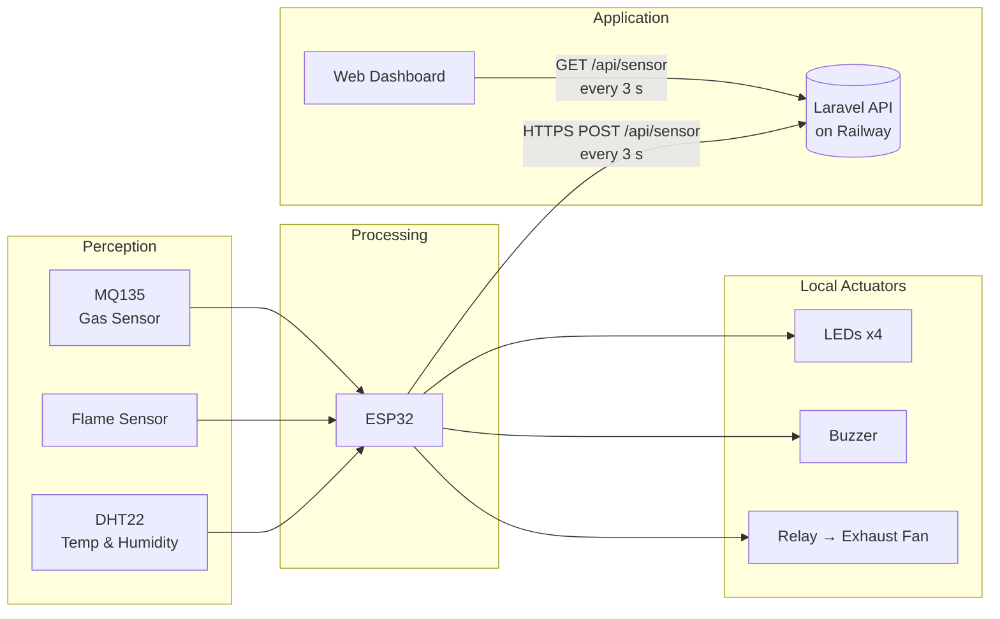

# 🧪 Safe Smart Laboratory — ESP32 IoT Safety Monitor

> A real-time IoT system that detects **flames**, **hazardous gas**, and **abnormal temperature** in a laboratory, reacts locally within milliseconds (LEDs, buzzer, exhaust fan), and streams everything to a **Laravel** web dashboard hosted on **Railway**.


---

## 📑 Table of Contents

1. [Overview](#-overview)
2. [Problem & Solution](#-problem--solution)
3. [Features](#-features)
4. [System Architecture](#-system-architecture)
5. [Hardware](#-hardware)
6. [Wiring / Pinout](#-wiring--pinout)
7. [Firmware Behavior](#-firmware-behavior)
8. [Backend (Laravel)](#-backend-laravel)
9. [Dashboard](#-dashboard)
10. [Getting Started](#-getting-started)
11. [Project Structure](#-project-structure)
12. [Pros & Cons](#-pros--cons)
13. [Known Limitations & Security Notes](#-known-limitations--security-notes)
14. [Future Improvements](#-future-improvements)
15. [Team & Credits](#-team--credits)

---

## 🔎 Overview

**Safe Smart Laboratory** is a university IoT project (course supervised by **Dr. Naglaa Fathy**, May 2026). An **ESP32** reads three environmental sensors, drives local safety actuators on its own (so protection still works if the internet drops), and posts readings every 3 seconds over HTTPS to a Laravel REST API. A web dashboard polls that API and shows the lab's live status from anywhere.

## ⚠️ Problem & Solution

**Problem:** Laboratories face a constant risk of gas leaks and fires. Human monitoring is slow, intermittent, and unreliable.

**Solution:** A smart system that continuously monitors environmental conditions in real time, triggers local alarms instantly, ventilates automatically on gas detection, and provides a remote monitoring dashboard.

**Objectives**
- Detect hazardous gases and flames instantly.
- Monitor temperature and humidity to catch fire precursors early.
- Provide a remote monitoring dashboard built with Laravel.

## ✨ Features

**Edge device (ESP32)**
- 🔥 Flame detection with a dedicated LED and a **continuous** buzzer tone.
- ☁️ Gas / air-quality detection with a dedicated LED and **automatic exhaust-fan activation** via relay.
- 🌡️ Temperature and humidity monitoring (DHT22) with an over-temperature warning (> 30 °C).
- 🟢 "Safe" status LED that turns off whenever any alarm is active.
- 🔔 Differentiated buzzer patterns: continuous for flame, intermittent beeping for gas/temperature.
- 📡 Wi-Fi auto-reconnect and HTTPS JSON uploads every 3 seconds.
- ⚡ Local protection works **independently of the cloud** — alarms never wait on the network.
- 🧠 Non-blocking buzzer logic using `millis()` timing.

**Web platform (Laravel)**
- REST API to ingest and read sensor data.
- Live dashboard that auto-refreshes every 3 seconds.
- Full-screen danger overlay (flame / gas / high temperature) that can be dismissed temporarily.
- Online/offline connection indicator and last-update time.
- Event history (last 20 events: alarm started, alarm cleared, high temperature).
- One-click cleanup of "safe" records.
- Cloud-hosted on Railway for 24/7 availability.

## 🏗 System Architecture

The project follows a classic four-layer IoT model:

| Layer | Component |
|---|---|
| **Perception** | DHT22, Flame sensor, MQ135 gas sensor |
| **Processing** | ESP32 microcontroller (Wi-Fi enabled) |
| **Transmission** | HTTPS `POST` requests carrying JSON |
| **Application** | Laravel web app (storage + dashboard), hosted on Railway |



## 🧰 Hardware

| Component | Role |
|---|---|
| ESP32 (DevKit) | Main controller with built-in Wi-Fi |
| DHT22 | Temperature & humidity |
| Flame sensor module (digital output) | Fire detection |
| MQ135 gas sensor module (digital output) | Hazardous gas / air quality |
| Relay module | Switches the exhaust fan |
| Fan | Ventilation on gas detection |
| Buzzer | Audible alarm |
| LEDs + resistors | Status indicators (flame, gas, temperature, safe) |

## 🔌 Wiring / Pinout

All sensors are powered from **3V3** and share **GND** with the ESP32 (as in the project report).

| Device | Device Pin | ESP32 Pin |
|---|---|---|
| DHT22 | VCC / GND / OUT | 3V3 / GND / **GPIO 21** |
| Flame sensor | VCC / GND / DO | 3V3 / GND / **GPIO 18** |
| MQ135 | VCC / GND / DO | 3V3 / GND / **GPIO 14** |
| Buzzer | + / − | **GPIO 27** / GND |
| LED – Flame | + / − | **GPIO 19** / GND |
| LED – Gas | + / − | **GPIO 25** / GND |
| LED – Temperature | + / − | **GPIO 4** / GND |
| LED – Safe | + / − | **GPIO 26** / GND |
| Relay (fan) | IN | **GPIO 5** |

> 💡 Use a current-limiting resistor (e.g. 220 Ω – 330 Ω) in series with every LED.
>
> 📝 The project report documents three LEDs in its wiring tables; the firmware additionally drives a temperature LED on GPIO 4 and the relay on GPIO 5. The table above reflects the firmware.

## 🧠 Firmware Behavior

File: [`SafeLab_ESP32.ino`](SafeLab_ESP32.ino)

| Condition | How it's detected | Local reaction | Sent to server |
|---|---|---|---|
| **Flame** | Flame DO pin reads `LOW` | Flame LED on, buzzer **continuous** 2 kHz tone | `flame: true` |
| **Gas** | MQ135 DO pin reads `LOW` | Gas LED on, relay `LOW` (fan on), buzzer beeps 200 ms on/off | `gas: true` |
| **High temp** | DHT22 > **30 °C** | Temp LED on, buzzer beeps | Raw `temperature` value |
| **Safe** | None of the above | Safe LED on, buzzer silent, relay off | all flags `false` |

**Main loop (every ~300 ms):** read DHT22 → evaluate flame, gas, temperature → update safe LED → drive buzzer → every 3 s send JSON to the server.

**Payload example**
```json
{ "temperature": 27.4, "humidity": 52.1, "flame": false, "gas": false }
```

**Required Arduino libraries:** `DHT sensor library` (Adafruit, + Adafruit Unified Sensor), `ArduinoJson` (v6 API — uses `StaticJsonDocument`), and the ESP32 core's built-in `WiFi`, `HTTPClient`, `WiFiClientSecure`.

## 🌐 Backend (Laravel)

Built with **Laravel 12** (PHP ≥ 8.2). The database table is `sensor_data`.

| Method | Endpoint | Description |
|---|---|---|
| `POST` | `/api/sensor` | Store a reading (`temperature`, `humidity`, `flame`, `gas` — all nullable, validated) |
| `GET` | `/api/sensor` | Return the latest reading (or zeros with `message: "no_data"`) |
| `POST` | `/api/sensor/clear-safe` | Delete every record where flame and gas are both false |
| `DELETE` | `/api/sensor/{id}` | Delete a specific record |
| `GET` | `/` | Dashboard page |

**Storage strategy:** when a new reading arrives and the previous one was "safe" (no flame, no gas), the previous record is deleted. The table therefore keeps only the latest safe reading plus the history of dangerous events, which keeps the database tiny.

**Database schema (`sensor_data`)**

| Column | Type | Default |
|---|---|---|
| `id` | bigint (PK) | — |
| `temperature` | float | 0 |
| `humidity` | float | 0 |
| `flame` | boolean | false |
| `gas` | boolean | false |
| `created_at` / `updated_at` | timestamps | — |

## 🖥 Dashboard

A single-page, dark-themed, responsive UI (Blade + Tailwind CSS CDN + vanilla JS; Arabic RTL interface) featuring:

- Overall **Safe / Danger** status banner.
- Temperature card with a gauge bar (turns red above 30 °C) and humidity card.
- Flame and gas cards with green/red indicators.
- Full-screen **danger overlay** with an icon matching the hazard.
- Event timeline and a **clear safe records** button.
- Connection indicator (turns grey when the API can't be reached).

## 🚀 Getting Started

### 1. Backend (local)

```bash
git clone https://github.com/<your-username>/IOTProject.git
cd IOTProject

composer install
cp .env.example .env
php artisan key:generate

# default DB is SQLite
touch database/database.sqlite
php artisan migrate

php artisan serve
# Dashboard: http://127.0.0.1:8000
```

### 2. Deploy to Railway

1. Push the repository to GitHub.
2. In Railway: **New Project → Deploy from GitHub repo**.
3. Set environment variables (`APP_KEY`, `APP_ENV=production`, `APP_DEBUG=false`, `APP_URL`, and database settings).
4. Run migrations (`php artisan migrate --force`) in the deploy command.
5. Generate a public domain and copy it.

> ⚠️ SQLite files are ephemeral on most PaaS platforms. For persistent history, attach a Railway MySQL/PostgreSQL service and set the `DB_*` variables.

### 3. Firmware

1. Install the **ESP32 board package** in the Arduino IDE and the libraries listed above.
2. Open `SafeLab_ESP32.ino` (keep it inside a folder with the same name, as the Arduino IDE requires).
3. Edit the three placeholders at the top of the file:
   ```cpp
   const char* ssid      = "YOUR_WIFI_SSID";
   const char* password  = "YOUR_WIFI_PASSWORD";
   const char* serverURL = "https://YOUR-APP-NAME.up.railway.app/api/sensor";
   ```
4. Select your ESP32 board, upload, and open the Serial Monitor at **115200 baud**.
5. Open your dashboard URL — data should appear within a few seconds.

### Quick API test (no hardware)

```bash
curl -X POST https://YOUR-APP-NAME.up.railway.app/api/sensor \
  -H "Content-Type: application/json" \
  -d '{"temperature":32.5,"humidity":48,"flame":false,"gas":true}'
```

## 📁 Project Structure

```
.
├── SafeLab_ESP32.ino                  # ESP32 firmware
├── app/
│   ├── Http/Controllers/SensorController.php
│   └── Models/Sensor.php
├── database/migrations/
│   └── 2026_05_09_044546_create_sensors_table.php
├── resources/views/dashboard.blade.php # Dashboard UI
├── routes/
│   ├── api.php                        # /api/sensor routes
│   └── web.php                        # Dashboard route
└── ...                                # Standard Laravel 12 files
```

## ✅ Pros & Cons

### Pros
- **Fast local response:** alarms and fan control run on the ESP32 itself and do not depend on Wi-Fi or the server.
- **Low cost:** inexpensive, widely available components.
- **Clear multi-level alerting:** different LEDs and buzzer patterns tell flame, gas, and temperature apart.
- **Automatic mitigation:** the exhaust fan starts on its own when gas is detected.
- **Remote visibility:** live cloud dashboard accessible from any device.
- **Lightweight storage:** only dangerous events are kept long-term.
- **Simple, modular code:** one function per sensor/actuator, non-blocking buzzer logic, easy to extend.
- **Resilient connectivity:** automatic Wi-Fi reconnection and request timeout handling.

### Cons
- Gas and flame sensors are **digital-only** — no gas concentration (ppm) or severity levels.
- The MQ135 targets general air quality, not specific combustible gases such as LPG or methane.
- The temperature threshold (30 °C) is hard-coded and low for many labs.
- No authentication on API endpoints; Wi-Fi credentials and server URL are hard-coded in firmware.
- TLS certificate validation is disabled (`setInsecure()`).
- Polling (3 s) instead of real-time push; no push/SMS/email notifications.
- Only the latest safe reading is kept, so there are no long-term temperature/humidity trends or charts.
- Sensor readings are not calibrated or filtered; no warm-up period for MQ sensors.

## 🛡 Known Limitations & Security Notes

- **Do not commit credentials.** Keep real Wi-Fi details out of version control; consider a `secrets.h` file listed in `.gitignore`.
- **Open API:** anyone who knows the URL can `POST`, `DELETE`, or clear records. Add an API key / token header before real-world use.
- **`client.setInsecure()`** skips server certificate verification and is vulnerable to man-in-the-middle attacks. Use `client.setCACert()` with the proper root certificate in production.
- **Blocking Wi-Fi connect:** `setup()` waits forever if the network is unavailable, so the local alarms won't start until Wi-Fi connects.
- **Blocking HTTP calls:** while a request is in flight (up to 10 s timeout), sensor handling pauses.
- **Failed DHT reads** skip the upload for that cycle.
- **Power:** MQ-series sensors normally need a 5 V heater supply and a warm-up time; verify your module's requirements on real hardware (the report's wiring uses 3V3).
- **Not a certified safety device.** This is an educational prototype and must not replace approved gas/fire detection equipment.

## 🔮 Future Improvements

- Analog MQ135 / flame readings with calibrated thresholds and ppm estimation.
- Move alarms and readings to **MQTT / WebSockets** for true real-time push.
- Telegram / WhatsApp / e-mail / SMS notifications.
- Authentication (API tokens, dashboard login) and rate limiting.
- Historical charts (Chart.js) and CSV export, plus a configurable retention policy.
- Remote-configurable thresholds and manual fan control from the dashboard.
- Non-blocking networking (FreeRTOS tasks), watchdog timer, and OTA firmware updates.
- Proper TLS pinning and secrets management.
- 3D-printed enclosure and a PCB instead of a breadboard.

## 👥 Team & Credits

**Supervisor:** Dr. Naglaa Fathy — *First Band, IoT Project, May 10, 2026*

**Students:**
- محمد أيمن فتحي محمد
- محمد عبدالله البليدي
- يوسف رجب يوسف
- محمد أيمن محمد سلطان
- محمد حماد محمد سلطان
- يوسف خالد محمد
- إبراهيم مصطفى علي
- أحمد محمد حجازي

Built with ❤️ using [ESP32](https://www.espressif.com/), [Laravel](https://laravel.com), [Tailwind CSS](https://tailwindcss.com), and [Railway](https://railway.app).

## 📄 License

Released for educational purposes. Add a license of your choice (e.g. MIT) before publishing publicly.
If you discover a security vulnerability within Laravel, please send an e-mail to Taylor Otwell via [taylor@laravel.com](mailto:taylor@laravel.com). All security vulnerabilities will be promptly addressed.

## License

The Laravel framework is open-sourced software licensed under the [MIT license](https://opensource.org/licenses/MIT).
